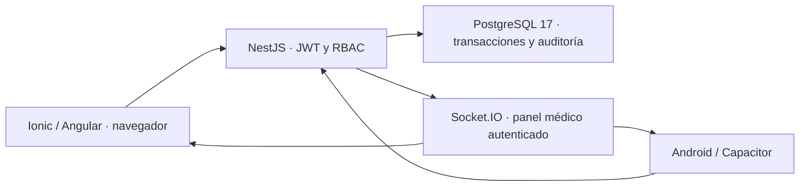

# INFORME FINAL DE ENTREGA 3 — SIT-CAMA

**Corte documental:** 16 de noviembre de 2026, hora de Bogotá. **Repositorio:** [yuliethqui/sit-cama-devsecops](https://github.com/yuliethqui/sit-cama-devsecops). **Rama:** feature/sit-cama-mvp-entrega-3. **Commit evaluado:** [50d7c0cdc39332a7b9e1837476f3c3060d78ae4f](https://github.com/yuliethqui/sit-cama-devsecops/commit/50d7c0cdc39332a7b9e1837476f3c3060d78ae4f).

**Actualización ALM:** 16 de noviembre de 2026, sobre HEAD documental bb8f0be2b3a75ba94f5201706f3ed32a56f2515f. Se incorporan las capturas de GitHub Projects; las pruebas y el run aprobado citados siguen correspondiendo a 50d7c0c, sin atribuirlos a una nueva ejecución.

**Estado de entrega:** MVP académico con controles técnicos comprobados y requisitos pendientes. PR #11 abierto; HU #12–#19 abiertas; publicación y firma del backend MVP bloqueadas. Este informe no constituye aceptación clínica, habilitación sanitaria ni autorización de despliegue.

## 1. Introducción

SIT-CAMA aborda el registro de pacientes sintéticos, la priorización académica de triaje, el censo de camas y la trazabilidad por roles. El caso de referencia es la Clínica San Rafael de Occidente descrita en la guía oficial suministrada por el estudiante.

Se contrastaron código, documentación, Issues, reportes originales de los cuatro experimentos y artefactos del pipeline aprobado. La fuente de evaluación es exclusivamente **Guia-Entrega-3-SIT-CAMA-v3.pdf**, 13 páginas, SHA-256 **0d2329ef229f0c60f5eba6bef46d89104fe302fa56fbe0fe06df2676ee615d75**. La rúbrica está en la página 13; los experimentos, en las páginas 10–11; el cuestionario, en las páginas 11–12. El encabezado interno dice «Taller ALM VERSIÓN 1.0»; se conserva la identificación y el hash del PDF recibido, sin sustituirlo por otro taller.

Las ejecuciones citadas son anteriores a esta preparación documental. Aquí se descargaron y verificaron evidencias; no se repitieron las pruebas de aplicación, los experimentos ni DAST.

## 2. Objetivo general y objetivos específicos

**Objetivo general:** documentar de forma verificable el alcance funcional y la defensa DevSecOps del MVP frente a la guía oficial, identificando las brechas de aceptación y publicación.

Objetivos específicos:

- Relacionar las tres épicas y ocho HU con planificación, criterios y evidencias.
- Diferenciar detección, rechazo local, controles positivos ejecutados en CI y bloqueo efectivo de un PR.
- Comprobar pruebas, cobertura, SAST, SCA, SBOM, DAST e identidades criptográficas.
- Entregar anexos íntegros y redactados, con procedencia, hashes y pendientes explícitos.

## 3. Descripción y arquitectura de SIT-CAMA

La aplicación principal reside en **apps/api** y **apps/mobile**. El Express del directorio raíz pertenece al laboratorio histórico y conserva sus archivos y antecedentes.

El backend utiliza NestJS 11 y Node 22.23.5; el frontend, Angular 22, Ionic 9 y Capacitor 8. PostgreSQL mantiene pacientes, triajes, camas, asignaciones y eventos. Se emplean consultas parametrizadas, cifrado AES-256-GCM de datos sensibles y HMAC para búsqueda exacta de documento. Las operaciones de cama y auditoría se coordinan transaccionalmente.

Los seis roles son ENFERMERO, MEDICO, ADMISIONES, COORDINADOR, SERVICIOS y AUDITOR. Los permisos se comprueban en el servidor; ocultar un control en la interfaz no concede autorización. JWT y datos de sesión del cliente permanecen en memoria.

El censo contiene 38 camas sintéticas y estados AVAILABLE, OCCUPIED, CLEANING y BLOCKED. Las asignaciones concurrentes tienen un único ganador y conflicto 409 para la operación incompatible. La auditoría dispone de filtros y paginación con identificadores numéricos grandes y comparación temporal hasta microsegundos.

**Límite clínico:** el motor ofrece únicamente demostración de I/II y deriva los demás casos a revisión profesional. Los ejemplos de 0 y 30 minutos proceden de la guía; no representan tiempos institucionales validados. No se inventan reglas ni tiempos para III–V. Mostrar categorías, registrar una decisión clínica profesional, configurar tiempos institucionales y clasificar automáticamente son capacidades distintas; su existencia no puede inferirse de una etiqueta. La ampliación automática requiere aprobación clínica y el enfermero no puede modificar directamente la clasificación.

Fuentes: [README](../README.md), [decisiones](decisiones-mvp.md), [HU-01/HU-03](HU-01-HU-03.md), [HU-05/HU-06](HU-05-HU-06.md), [frontend](frontend.md) y [Android](android-debug.md).

## 4. Gestión ALM

### Épicas y planificación

Se conservan los nombres oficiales: **EP-01 Triaje clínico digital normativo (Resolución 5596/2015)**; **EP-02 Censo y disponibilidad de camas en tiempo real**; **EP-03 Seguridad asistencial, trazabilidad y cumplimiento normativo**. Son categorías del backlog, no certificaciones de cumplimiento.

| HU / Issue | Épica | Sprint previsto | Prioridad / SP | Status en Projects | Alcance comprobado y aceptación pendiente |
|---|---|---|---|---|---|
| [HU-01 / #12](https://github.com/yuliethqui/sit-cama-devsecops/issues/12) | EP-01 | 1 | Must Have / 5 | In Progress | Parcial: demostración I/II; faltan I–V completos y validación clínica. |
| [HU-02 / #13](https://github.com/yuliethqui/sit-cama-devsecops/issues/13) | EP-01 | 1 | Must Have / 3 | Security Review | Panel, eventos y alarma implementados; activación de sonido por el usuario y aceptación formal pendientes. |
| [HU-03 / #14](https://github.com/yuliethqui/sit-cama-devsecops/issues/14) | EP-01 | 1 | Should Have / 2 | In Progress | Búsqueda exacta implementada; falta acreditar <500 ms bajo carga acordada y espera asistencial real. |
| [HU-04 / #15](https://github.com/yuliethqui/sit-cama-devsecops/issues/15) | EP-02 | 2 | Must Have / 5 | Security Review | Censo e interfaz presentes; aceptación institucional y sincronización entre clientes pendientes. |
| [HU-05 / #16](https://github.com/yuliethqui/sit-cama-devsecops/issues/16) | EP-02 | 2 | Must Have / 3 | Security Review | Limpieza autorizada y auditoría implementadas; DoD y aceptación formal pendientes. |
| [HU-06 / #17](https://github.com/yuliethqui/sit-cama-devsecops/issues/17) | EP-02 | 2 | Should Have / 3 | In Progress | Parcial: asignación actual solo MEDICO; la guía contempla médico o enfermero y actualización WebSocket <1 s no acreditada. |
| [HU-07 / #18](https://github.com/yuliethqui/sit-cama-devsecops/issues/18) | EP-03 | 1 | Must Have / 3 | Security Review | JWT/RBAC y minimización comprobados técnicamente; validación institucional de privacidad pendiente. |
| [HU-08 / #19](https://github.com/yuliethqui/sit-cama-devsecops/issues/19) | EP-03 | 2 | Must Have / 3 | In Progress | Parcial: consulta y protección de auditoría; falta reclasificación III→II por especialista con motivo y prueba de inmutabilidad frente al administrador de BD. |

La vista **Planificación SIT-CAMA** contiene los campos Épica, Sprint, Prioridad, Story Points y Status. Las ocho HU suman **27 SP planificados**: 13 en Sprint 1 y 14 en Sprint 2, distribuidos en **tres épicas, dos sprints, seis Must Have y dos Should Have**. Hay cuatro HU en **In Progress** (HU-01, HU-03, HU-06 y HU-08) y cuatro en **Security Review** (HU-02, HU-04, HU-05 y HU-07). **Ninguna HU está en Done ni se declara formalmente completada.** Security Review expresa un estado de trabajo; no acredita revisión por pares ni aprobación de seguridad. No se presenta velocidad, burndown ni ejecución de sprints sin evidencia.

### DoR, DoD y Gherkin

Los ocho Issues contienen planificación, DoR, DoD y escenarios Gherkin. La guía exige historias INVEST, escenario normal y alterno/crítico, interacción o mockup, estimación y dependencias resueltas. Que un checklist esté redactado no prueba que se haya satisfecho.

La DoD oficial incluye linters, cobertura mínima del 80%, controles de seguridad, revisión por pares, imagen escaneada **y firmada**, staging y aceptación del Product Owner. La firma MVP y la aceptación formal siguen pendientes; no se cierran las HU por tener CI verde.

Ejemplo oficial HU-08: Dado un paciente III y un especialista autorizado, cuando se reclasifique a II por deterioro con motivo, entonces deben conservarse actor, momento, valor previo y razón. La auditoría genérica existente no acredita este escenario. Los ejemplos clínicos de la guía son requisitos a validar, no reglas nuevas aprobadas en este informe.

### GitHub Projects y PR #11

[PR #11](https://github.com/yuliethqui/sit-cama-devsecops/pull/11) sigue abierto. Su cuerpo enlaza #12–#19 y reconoce **trazabilidad retrospectiva**. La guía pide que cada rama y commit partan de un Issue: añadir referencias posteriormente no demuestra esa disciplina histórica.

El proyecto GitHub Projects **Tablero_Kanban** está configurado con las ocho HU #12–#19. Se inspeccionaron las capturas de [Kanban](evidence/entrega-3/github-projects-kanban.png.png) y [Planificación SIT-CAMA](evidence/entrega-3/github-projects-planificacion.png.png): confirman los campos, los valores de planificación y los estados indicados arriba. También muestran seis elementos históricos en Backlog; los totales de esta sección se refieren únicamente a HU-01–HU-08.

**URL directa del tablero:** no verificada en esta revisión. Las capturas no incluyen la barra de direcciones y no fue posible comprobarla mediante el navegador; no se inventa un enlace. Las rutas originales, los hashes y el alcance de la inspección constan en el [inventario](ENTREGA-3-INVENTARIO-EVIDENCIAS.md).

La nueva consulta de revisiones del PR devuelve una lista vacía. **Siguen pendientes la revisión por pares, la aceptación del Product Owner y la trazabilidad histórica estricta de ramas, commits y PRs desde los Issues.** La configuración del tablero no subsana retrospectivamente esos requisitos ni acredita la DoD.

## 5. Arquitectura DevSecOps y Quality Gates

El workflow activo es [.github/workflows/mvp-ci.yml](../.github/workflows/mvp-ci.yml). Herramientas fijadas en [.ci/tools.lock.json](../.ci/tools.lock.json): Gitleaks 8.30.1, Semgrep 1.185.0, Trivy 0.76.2, Syft 1.57.1, ZAP 2.17.0 y Cosign 3.1.4; las imágenes están fijadas por digest.

| Control | Alcance y condición de rechazo |
|---|---|
| Gitleaks | Hook sobre staged y CI sobre historial disponible, con redacción total; detección implica fallo. |
| Pruebas y cobertura | API y frontend: mínimo 80% en statements, branches, functions y lines; build, lint del frontend y E2E. |
| Semgrep | Reglas OWASP JavaScript y propias; ERROR, errores de análisis o ausencia de archivos impiden aprobación. |
| Trivy | Dependencias incluidas las de desarrollo, configuración e imagen; cualquier HIGH/CRITICAL bloquea, también sin corrección disponible. |
| Syft | SBOM CycloneDX no vacío de la imagen efectivamente escaneada. |
| DAST | Autenticación y RBAC verificados; fallo del escáner, ausencia de acceso autenticado o alertas MEDIUM/HIGH bloquean. |
| Publicación | Requiere ambos jobs, main, despacho manual autorizado, revisión de riesgo aprobada y concordancia de bases. Actualmente bloqueada. |

El [run 43924092624](https://github.com/yuliethqui/sit-cama-devsecops/actions/runs/43924092624) corresponde al HEAD evaluado: Quality **success**, Image/DAST **success**, publicación **skipped**. El salto de publicación en un PR obedece al evento; además, la política rechaza de forma independiente el estado blocked.

**Diferencia respecto a la guía:** Quality e Image/DAST corren en paralelo. Un ERROR SAST hace fallar Quality y evita publicación, pero no garantiza impedir que comience la construcción. Por tanto, no está acreditado el requisito del Experimento 2 de detenerse antes del empaquetado. No se modificó el workflow para ocultar esa diferencia.

El ejemplo de la guía se declara adaptable a la plataforma. El MVP usa DAST autenticado de API en red Docker efímera en lugar de una URL pública Baseline. No se encontró evidencia de admisión Kubernetes/Kyverno, asociación HU en todos los artefactos ni acreditación SLSA nivel 3. Firmar una imagen por sí solo no demuestra ese nivel.

## 6. Experimento 1: Gitleaks

En experiment/mvp-gitleaks, partiendo de 50d7c0c, se preparó un único marcador sintético académico. La regla vigente **github-pat** detectó la línea 5 de experiments/entrega-3/gitleaks/synthetic-secret.txt. El intento de commit normal y el análisis staged devolvieron **1**; HEAD no cambió y no se creó commit.

La evidencia muestra el secreto como REDACTED. Su original permanece preservado localmente, fuera de los anexos entregables. Se generó una selección derivada de seis registros redactados y su manifiesto, sin copiar el marcador ni el respaldo del índice.

El artefacto Quality aprobado acredita que el control positivo corrió **dentro de GitHub Actions**: staged vulnerable 1, staged limpio 0, hook rechaza 1 y commit limpio del repositorio desechable pasa. El orquestador devuelve éxito al observar esos resultados esperados. Esto prueba la ejecución remota del control positivo, **no un PR vulnerable bloqueado**.

La guía exige también omitir deliberadamente el hook y observar rechazo del PR y bloqueo de merge. Esa fase no se realizó. El marcador histórico de feature/test-secret utiliza una regla educativa diferente; se conserva su [tratamiento específico pendiente](TRATAMIENTO-MARCADOR-GITLEAKS.md), sin borrar historia ni aplicar excepciones generales. No se confunde con el detector vigente github-pat.

## 7. Experimento 2: Semgrep

Semgrep 1.185.0 analizó ocho fixtures aislados. La regla **sitcama.pg-input-concatenation**, severidad **ERROR**, CWE-89, sigue datos de req.body/query/params hasta el primer argumento SQL de DB.query. Detectó cuatro casos: concatenación de entrada, alias TypeScript equivalente a la rúbrica, interpolación histórica y control positivo.

Con --error el escáner devolvió **1**. Los controles parametrizado, concatenación constante y cadena sin ejecución SQL no produjeron hallazgos. El caso DTO sin fuente HTTP reconocida delimita el alcance: ausencia de alerta no prueba seguridad universal.

El export limpio del MVP tuvo 95 archivos, cero hallazgos y salida 0. Una copia aislada con fixture tuvo 96 archivos y un ERROR: en modo comparable a CI el escáner generó JSON con salida **0** y el evaluador del criterio SAST devolvió **1**. El código funcional no recibió la vulnerabilidad.

[PR #8](https://github.com/yuliethqui/sit-cama-devsecops/pull/8), cerrado sin merge, y [run histórico 42743048872](https://github.com/yuliethqui/sit-cama-devsecops/actions/runs/42743048872) aportan contexto del Express anterior. El run fue un push posterior al cierre, con Semgrep 1.184.0 y otra regla; no prueba bloqueo del PR #8 ni del MVP actual.

**Resultado:** detección y rechazo local demostrados; control positivo Semgrep también registrado en CI. Falta un PR experimental bloqueado por el job vigente y acreditar el orden previo al empaquetado exigido por la guía.

## 8. Experimento 3: Trivy

Se construyeron proyectos Node independientes bajo .reports/experiment-3/projects/, con sus propios manifiestos y lockfiles. No se instalaron node_modules ni se ejecutaron scripts de paquetes. El backend conserva jsonwebtoken **9.0.3**, transitivo de @nestjs/jwt; no recibió 8.5.1.

| Dependencia aislada | CVE detectada | Severidad GHSA / CVSS | Corrección mínima |
|---|---|---|---|
| jsonwebtoken 8.5.1 | CVE-2022-23539 | HIGH / 8.1 | 9.0.0 |
| jsonwebtoken 8.5.1 | CVE-2022-23540 | MEDIUM / 6.4 | 9.0.0 |
| jsonwebtoken 8.5.1 | CVE-2022-23541 | MEDIUM / 5.0 | 9.0.0 |

Trivy 0.76.2 produjo JSON con **salida 0** por configuración. La función original trivyGate y su condición de rechazo produjeron **salida 1** por el HIGH. Hubo cero CRITICAL; no se inventa uno para cumplir el enunciado. El control limpio con 9.0.3 tuvo cero hallazgos y gate **0**. CVE-2022-23529 está retirada y no se cuenta.

Se compararon dos snapshots de Trivy DB esquema 2, actualizados el 16 de noviembre a las 13:03 y 18:50 UTC: hashes distintos y los mismos tres resultados. Se registran hashes y metadatos; las bases de aproximadamente 1,75 GB no se incluyen en ZIP. Fuente de distribución: mirror.gcr.io/aquasec/trivy-db:2; las severidades citadas proceden de GitHub Security Advisory.

**Resultado:** Experimento 3 demostrado localmente con control limpio. No se ejecutó un PR con dependencia vulnerable y no se declara bloqueo remoto de ese PR. La presencia del paquete no prueba explotación del despliegue clínico.

## 9. Experimento 4: Cosign

Las verificaciones públicas usaron Cosign 3.1.4 y salida **0**:

| Objeto verificado | Digest SHA-256 | Identidad / issuer |
|---|---|---|
| Base Distroless cc-debian13:nonroot | cb87acc574abe719b6e5c547384defa2f7b1f24af9605d3f618cf852495d8be2 | keyless@distroless.iam.gserviceaccount.com / https://accounts.google.com |
| Express histórico ghcr.io/yuliethqui/sit-cama-devsecops | 87dbfec2d837eae5825e55e63eda7bb690e3bdbee5265c5c5187a371a318cd57 | sign-image.yml@refs/heads/main del repositorio / https://token.actions.githubusercontent.com |

Una identidad Distroless incorrecta devolvió **12**, como rechazo esperado. Los payloads verificados corresponden a los digests indicados. [PR #10](https://github.com/yuliethqui/sit-cama-devsecops/pull/10) y [run 42752729344](https://github.com/yuliethqui/sit-cama-devsecops/actions/runs/42752729344) documentan firma histórica de Express, no de apps/api.

La imagen del pipeline MVP tiene imageId **sha256:b29cdd16642c8b531092f74e85ff3e238f72002887d956d29a9c26e0c0ab240b**. Es un identificador de imagen Docker local al job: **no es un digest publicado en OCI ni evidencia de firma MVP**.

La comprobación local de assertPublicationReview devolvió **1** con blocked. [.ci/publication-review.json](../.ci/publication-review.json) permanece idéntico, SHA-256 **40a0e9871c2e040a63f35738785e0e6717b653f842d19c2ea15f18f1ce826265**, con NODE22-BUNDLED-ZLIB-GZWRITE en investigación.

La revisión existente de CVE-2026-85091 señala condiciones específicas de fallo de escritura gz_write y posterior escritura; no establece una ruta explotable de SIT-CAMA. Hay que distinguir zlib del sistema y la integrada en Node, inventariar el binario exacto, revisar addons/rutas nativas y realizar pruebas controladas autorizadas. La asociación histórica de CVE-2026-76844 con zlib requiere reconciliación: la fuente revisada la relaciona con webpack-dev-middleware. No se descarta riesgo ni se modifica la investigación.

Para completar el experimento: resolver formalmente la revisión; obtener aprobación de integración/publicación; ejecutar los gates sobre main autorizado; publicar la imagen escaneada en el repositorio OCI del backend; firmar keyless y verificar **el mismo digest**, identidad exacta mvp-ci.yml@refs/heads/main e issuer de GitHub Actions; verificar también la atestación SBOM. El [procedimiento preservado](../.reports/experiment-4/export-reviewed/PROCEDIMIENTO-PENDIENTE.md) detalla los pasos. No se ejecutaron publicación, firma MVP ni workflow_dispatch.

## 10. Resultados de pruebas automatizadas

Los siguientes datos proceden de los ZIP originales del **run 43924092624**, descargados y verificados ahora; no son nuevas ejecuciones locales.

| Comprobación | Resultado del pipeline aprobado |
|---|---|
| API en Quality | 18 suites, 244/244, cero fallos. |
| API Linux/Docker en Image/DAST | Las mismas 18 suites y 244/244, en una ejecución distinta; no se suman como 488 pruebas diferentes. |
| Frontend unitario | 105/105 pruebas. |
| Navegador Playwright | 43 aprobadas, cero inesperadas, cero omitidas y cero flaky; resoluciones 360/768/1440. |
| Build y lint | API build, frontend lint y build Ionic de producción aprobados. No se inventa un paso de lint API que no existe. |
| Runtime final | JWT, cifrado/búsqueda/triaje, 38 camas, conflicto 409, limpieza, panel, auditoría y denegación SERVICIOS aprobados. UID 10001, raíz de solo lectura y sin capabilities. |

| Cobertura remota | Statements | Branches | Functions | Lines | Umbral por métrica |
|---|---:|---:|---:|---:|---:|
| API, Quality y Linux | 99,50% | 92,77% | 99,03% | 100% | 80% |
| Frontend | 84,49% | 86,81% | 81,63% | 87,45% | 80% |

La cobertura corresponde al alcance instrumentado de cada configuración; no mide validación clínica ni cobertura nativa Android. La regresión de auditoría por 1 microsegundo está incluida en la suite aprobada; un fallo descrito en informes anteriores no debe atribuirse al HEAD actual.

El SAST del MVP analizó 95 archivos: cero hallazgos. SCA de API registró dos MEDIUM (glob/minimatch) y frontend un MEDIUM (minimatch), sin HIGH/CRITICAL. IaC registró DS-0026 LOW sobre el Dockerfile histórico raíz; el runtime MVP sí tiene HEALTHCHECK verificado. La imagen produjo **1681 componentes CycloneDX 1.7 y cero hallazgos bloqueantes**, lo cual no resuelve por sí solo la investigación manual de zlib.

## 11. Análisis DAST con OWASP ZAP

ZAP 2.17.0 ejecutó **zap-api-scan.py**, con contrato OpenAPI parcial, PostgreSQL desechable, usuarios sintéticos y red interna sin puertos publicados. No fue un Baseline contra staging público. El reporte confirma readiness PostgreSQL por TCP 127.0.0.1, tres intentos y 2233 ms; se superó el fallo histórico del socket durante inicialización.

| Identidad | Alcance declarado | Evidencia de acceso efectivo | Alertas |
|---|---|---|---|
| MEDICO | health, beds, triage/panel, patients/search y triage/preview | 10 lecturas autenticadas auditadas del panel | Una clase informativa de respuesta 4xx; 27 instancias; cero MEDIUM/HIGH. |
| AUDITOR | audit/events | 10 lecturas autenticadas auditadas de auditoría | Una clase informativa de respuesta 4xx; 20 instancias; cero MEDIUM/HIGH. |

Las cinco sondas RBAC dieron lo esperado: MEDICO/panel **200**, AUDITOR/auditoría **200**, SERVICIOS/panel **403**, SERVICIOS/auditoría **403**, anónimo/camas **401**. Los conteos prueban acceso a handlers protegidos; no acreditan exhaustividad de todos los endpoints ni pruebas de carga.

Se verificaron los cuatro archivos originales **zap-medico.html/json** y **zap-auditor.html/json**, junto con dast.json. El job terminó success y conservó los criterios de bloqueo. El script limita su limpieza a los recursos con identificador aleatorio creados en esa ejecución; este trabajo documental no creó, eliminó ni manipuló contenedores, redes, imágenes, datos o volúmenes.

## 12. Evidencias de funcionamiento del MVP y Android

Se inspeccionaron las cuatro capturas web de docs/evidence/tema-azul/360/: login vacío, registro explícitamente sintético, panel médico y auditoría. No muestran contraseñas ni JWT; los identificadores visibles proceden del escenario sintético documentado. Son capturas de navegador de 360 px del 14 de noviembre, no pantallas Android ni prueba actual de rendimiento.

El código confirma censo y colores oficiales en apps/mobile/src/styles/_pages.scss: AVAILABLE #2ECC71, OCCUPIED #2980B9, CLEANING #F1C40F y BLOCKED #7F8C8D. Esto acredita implementación, pendiente de aceptación funcional institucional.

Android/Capacitor y el perfil debug están implementados. [android-debug.md](android-debug.md) documenta compilación/instalación y conectividad histórica en emulador, con excepción restringida a http://10.0.2.2:3000/api y verificación nativa de APK depurable. Un 401 con cuenta ficticia inexistente prueba conectividad, no login válido ni las ocho HU.

En este clon **no están** app-debug.apk ni la captura android-debug-login.png citada históricamente. No se reconstruyeron ni se inventaron hashes. El estudiante debe adjuntar el APK exacto, hash, procedencia de build y evidencia Android sintética revisada. La configuración release necesita endpoint HTTPS autorizado y validación propia.

## 13. Riesgos, limitaciones y trabajo pendiente

| Riesgo o brecha | Evidencia necesaria para cerrarla |
|---|---|
| Aceptación clínica incompleta, HU-01 y HU-08 parciales | Protocolo y responsables clínicos; separar presentación III–V, decisión profesional, tiempos institucionales y reglas aprobadas; validar reclasificación y trazabilidad. |
| Diferencias de HU-03/HU-06 | Mediciones acordadas <500 ms / <1 s, espera por episodio y resolución explícita de permisos de asignación. No ampliar permisos de clasificación del enfermero. |
| Gobernanza ALM | Tablero, campos y estados acreditados por dos capturas; falta verificar su URL directa. Mantener pendientes revisión por pares, aceptación PO y trazabilidad histórica estricta. |
| Experimentos 1–3 sin PR vulnerable bloqueado | Evidencia del check fallido atribuible al detector y protección de merge, en entorno autorizado; no publicar fixtures peligrosos en el MVP. |
| Empaquetado paralelo al SAST | Evaluación del orden exigido por la guía; la publicación sí depende de ambos jobs. No se cambió CI en este trabajo. |
| Firma del backend MVP pendiente | Revisión zlib y autorización formal; luego publicación/firma/verificación del digest propio. |
| Alcance de defensa limitado | DAST parcial, MEDIUM de dependencias pendientes de revisión y sin prueba de admisión Kyverno/Kubernetes o SLSA 3. |
| Android y aceptación institucional | APK con hash, capturas/video sintéticos revisados, validación release; no equiparar capturas web con Android. |
| Caducidad de artefactos GitHub | Conservar los ZIP descargados: Quality/Image reportes expiran el 30/11/2026; scanned-image expira el 17/11/2026 y no se descargó por no ser necesario para este informe. |

### Cumplimiento de la rúbrica oficial (página 13)

Las ponderaciones se transcriben de la guía. **No se asigna nota ni porcentaje de cumplimiento.**

| Dimensión oficial | Peso oficial | Criterio oficial de aceptación y evidencia requerida | Estado sustentado |
|---|---:|---|---|
| 1. Gestión ALM y Backlog Completo | 20% | Las 8 Historias de Usuario (HU-01 a HU-08) cargadas en el tablero Kanban con DoR, DoD, criterios Gherkin y trazabilidad estricta de ramas y PRs. | Parcial: ocho HU en Tablero_Kanban con campos y estados acreditados por capturas, cero Done; revisión por pares, aceptación PO, trazabilidad histórica estricta y DoD pendientes. |
| 2. Shift-Left Local y Secret Scanning | 20% | Hook pre-commit funcional y pipeline de CI bloqueando credenciales simuladas en el Experimento 1. | Hook y control positivo en Actions comprobados; falta PR vulnerable bloqueado conforme al procedimiento oficial. |
| 3. Calidad Estática (SAST) y Dependencias (SCA) | 25% | Semgrep y Trivy configurados correctamente bloqueando la inyección SQL (Experimento 2) y dependencias vulnerables (Experimento 3). | Rechazo local demostrado; faltan PRs bloqueados y detención previa al empaquetado del Experimento 2. |
| 4. Seguridad en Contenedores y Firma Cosign | 20% | Dockerfile optimizado, imagen OCI escaneada y verificación criptográfica exitosa con Cosign (Experimento 4). | Construcción/escaneo/runtime comprobados. Firmas base e histórica válidas; firma de imagen MVP pendiente. |
| 5. Análisis Dinámico (DAST) y Cuestionario | 15% | Reporte HTML de OWASP ZAP generado en Staging y respuestas fundamentadas al cuestionario técnico. | HTML/JSON autenticados en staging Docker aislado y cuestionario respondido. Adaptación API scan frente a Baseline debe declararse; no hubo staging público. |

## 14. Cuestionario técnico de la guía

Las cinco preguntas siguientes se transcriben de las páginas 11–12, uniendo únicamente los saltos de línea.

**1. Gobernanza y ALM: ¿Cómo garantiza la disciplina de Trunk-Based Development combinada con Quality Gates que una aplicación asistencial cumpla con los estándares de habilitación de la Resolución 3100 de 2019?**

Las ramas breves, integración frecuente y revisión por PR permiten relacionar requisitos, cambios y resultados. Los gates aportan evidencia repetible de pruebas, vulnerabilidades y procedencia del artefacto, y pueden impedir integrar cambios que incumplan políticas. Sin embargo, esa disciplina no garantiza por sí sola habilitación: la resolución regula condiciones del prestador y requiere verificaciones que exceden el software. Se necesita validación institucional, clínica y de procesos. SIT-CAMA demuestra controles técnicos, pero aún tiene HU parciales, trazabilidad retrospectiva, aceptación y firma MVP pendientes; no se declara cumplimiento sanitario. Véase la [Resolución 3100, artículos 1 y 3 y sus modificaciones](https://jurinfo.jep.gov.co/Normograma/compilacion/docs/resolucion_minsaludps_3100_2019.htm).

**2. Defensa en Profundidad: ¿Por qué la detección de secretos debe operar tanto en el entorno local (pre-commit) como en el pipeline remoto (CI)? ¿Qué ocurre si un desarrollador utiliza --no-verify?**

El hook reduce la posibilidad de incorporar un secreto y ofrece corrección inmediata; es un control del equipo local que puede omitirse. --no-verify omite ese hook, pero no elimina el escaneo independiente de CI. Para impedir un merge, el check correspondiente debe fallar y ser obligatorio en la protección de la rama. Aquí el hook rechazó el marcador y Actions comprobó el control positivo en un repositorio desechable. No se omitió el hook del experimento ni se abrió un PR vulnerable; por ello no se afirma haber demostrado ese bloqueo remoto o la protección efectiva de merge.

**3. SAST vs. DAST: Compare las capacidades de Semgrep y OWASP ZAP. ¿Qué vulnerabilidad puede detectar ZAP que Semgrep no es capaz de ver en el código estático?**

Semgrep analiza patrones y flujos de datos sin ejecutar la aplicación: en este laboratorio detectó entrada HTTP concatenada en SQL. ZAP envía solicitudes al sistema en ejecución y observa respuestas y configuración efectiva. Por ejemplo, puede detectar cabeceras de seguridad ausentes o divulgación causada por un proxy desplegado cuya configuración no está en el código analizado por Semgrep. También permite verificar acceso autenticado en condiciones reales de ejecución. Es un ejemplo conceptual, no un hallazgo atribuido a SIT-CAMA: los reportes revisados solo registran una clase informativa 4xx por rol y ningún MEDIUM/HIGH en el subconjunto evaluado.

**4. Protección de Datos Médicos (Ley 1581): A la luz de la legislación colombiana, ¿cuál es la responsabilidad técnica del equipo de desarrollo respecto al registro de datos de triaje en los logs del servidor?**

Los datos de salud son sensibles; un log que los contenga también los trata y requiere protección. El equipo debe aplicar minimización y finalidad, evitar cuerpos clínicos completos, documentos, contraseñas y JWT en logs operativos, controlar accesos y exportaciones, y proteger almacenamiento y retención según la política institucional. La auditoría necesaria debe registrar el mínimo autorizado y conservar trazabilidad sin duplicar indiscriminadamente la historia clínica. Estas son medidas técnicas derivadas de los principios de acceso restringido, seguridad y confidencialidad; no reemplazan las obligaciones del responsable del tratamiento. Las evidencias académicas usan únicamente datos sintéticos. Véase [Ley 1581, artículos 4–6 y 17–18](https://jurinfo.jep.gov.co/Normograma/compilacion/docs/ley_1581_2012.htm).

**5. Cadena de Suministro: ¿De qué manera el uso combinado de Syft (SBOM) y Cosign mitiga ataques de envenenamiento de paquetes o sustitución de contenedores en el registro OCI?**

Syft inventaría componentes del artefacto; permite relacionarlos con advisories y revisar cambios. Cosign vincula criptográficamente un digest con una identidad de firma; verificar identidad e issuer esperados dificulta aceptar una sustitución no autorizada. La atestación de SBOM liga inventario y artefacto cuando también se valida. Ninguno garantiza que un paquete firmado sea benigno: siguen siendo necesarios SCA, versiones fijadas, revisión y procedencia del build. En este MVP se generó SBOM y se verificó la base, pero no se firmó el backend. La verificación de Express histórico no cubre esa brecha ni acredita SLSA 3.

## 15. Conclusiones

El tablero Tablero_Kanban acredita la planificación de las ocho HU: tres épicas, dos sprints y 27 SP, con cuatro In Progress y cuatro Security Review. Ninguna HU se declara Done; revisión por pares, aceptación PO y trazabilidad histórica estricta siguen pendientes.

El MVP cuenta con pruebas y controles de seguridad reproducibles, un pipeline remoto aprobado y evidencia de acceso autenticado con RBAC. Los experimentos 1–3 prueban localmente rechazo selectivo; Actions ejecutó controles positivos, pero no se demostraron PRs vulnerables bloqueados con la configuración vigente.

Cosign verificó correctamente Distroless y Express histórico. La firma del backend, los requisitos clínicos pendientes y la aceptación formal continúan abiertos. Mantener blocked preserva una decisión de seguridad explícita aunque los escaneos automáticos no reporten HIGH/CRITICAL.

La entrega se apoya en ZIP íntegros y hashes comprobados, y hace visible qué debe aportar o autorizar después el estudiante. Durante esta preparación permanecieron intactos los 317 archivos originales, el historial, el índice Git y la política de publicación.

## 16. Referencias y anexos de evidencia

- Guía oficial suministrada: C:\Users\Usuario\Downloads\Guia-Entrega-3-SIT-CAMA-v3.pdf; páginas y SHA-256 identificados en la introducción. Es la única fuente de rúbrica y cuestionario.
- [PR #11 y referencias HU](https://github.com/yuliethqui/sit-cama-devsecops/pull/11); [Quality aprobado](https://github.com/yuliethqui/sit-cama-devsecops/actions/runs/43924092624/job/133498820735); [Image/DAST aprobado](https://github.com/yuliethqui/sit-cama-devsecops/actions/runs/43924092624/job/133498821235).
- Capturas ALM inspeccionadas: [Kanban](evidence/entrega-3/github-projects-kanban.png.png) y [Planificación SIT-CAMA](evidence/entrega-3/github-projects-planificacion.png.png), con hashes en el inventario. No se verificó una URL directa del proyecto.
- Originales locales: .reports/experiment-1/result.json y .reports/experiment-2, experiment-3 y experiment-4/export-reviewed/. Los anexos Gitleaks entregables excluyen su marcador.
- [Advisory CVE-2022-23539](https://github.com/advisories/GHSA-8cf7-32gw-wr33), [CVE-2022-23540](https://github.com/advisories/GHSA-qwph-4952-7xr6), [CVE-2022-23541](https://github.com/advisories/GHSA-hjrf-2m68-5959): fuentes preservadas en Experimento 3.
- [Revisión de zlib existente](../.reports/experiment-4/export-reviewed/zlib-review.json); fuentes y límites registrados allí, sin alterar la investigación.
- [Inventario de anexos, rutas, hashes y entrega manual](ENTREGA-3-INVENTARIO-EVIDENCIAS.md). Los enlaces hacia .reports son **locales**: esos archivos están ignorados por Git y se adjuntan manualmente; no son publicaciones en GitHub.
